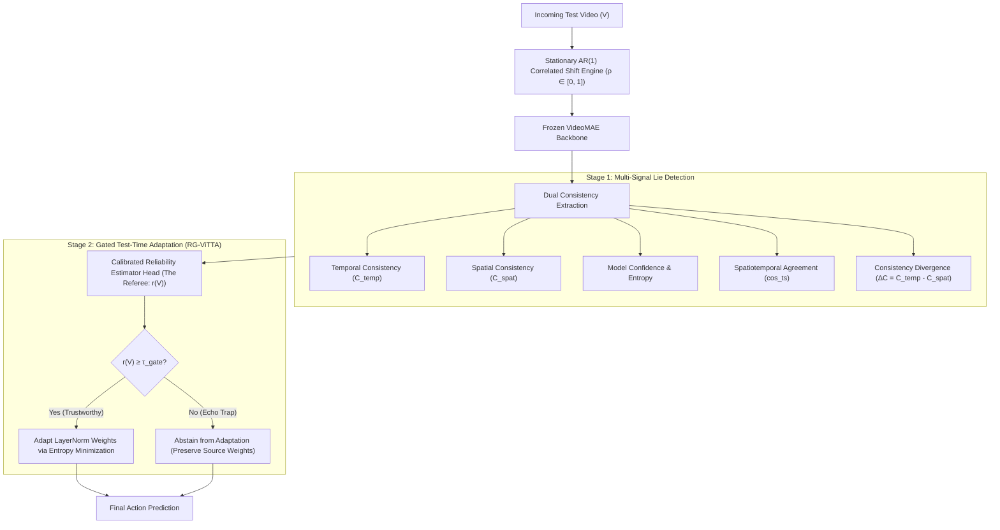

# Video Test-Time Adaptation Under Correlated Distribution Shifts (RG-ViTTA)

**Course Project — Applied Foundations of Machine Learning (AFML)**  
**Team Strawhat Pirates:** Samarth P Kulkarni, B Thrivikram, Mohammad Faizan  
**Pretrained Backbone:** VideoMAE (`videomae-base-finetuned-ucf101`)  
**Target Benchmark:** UCF-101 Action Recognition under Correlated Corruptions  

---

## 📌 Abstract & Motivation

Video Test-Time Adaptation (TTA) aims to adapt pretrained video recognition models to unseen test-time distribution shifts (e.g., weather degradation, motion blur, sensor noise, compression) without access to source training data or ground-truth supervision. 

Existing video TTA frameworks (such as ViTTA and TempT) rely heavily on **temporal prediction consistency** as a self-supervisory objective under the core assumption:
$$\text{Temporal Agreement Across Frames} \implies \text{Prediction Reliability}$$

### The "Echo Chamber Trap"
In real-world video distribution shifts, corruptions are **temporally correlated**: consecutive frames experience nearly identical noise, blur, or compression artifacts. As the temporal correlation $\rho \to 1$:
1. The model makes a consistent, confident, yet incorrect prediction across consecutive frames.
2. Temporal consistency metrics register high agreement, misinterpreting systematic corruption for semantic certainty.
3. Blind consistency-driven adaptation forces the network to optimize towards its own erroneous predictions, poisoning the model's weights and causing **Harmful Adaptation (HAR)**.

To break this failure mode, we propose **Reliability-Guided ViTTA (RG-ViTTA)**: a dual-signal reliability framework that pits **spatial perturbation invariance** against temporal consistency to expose echo chamber traps and selectively govern test-time weight updates.

---

## 🏛️ Methodological Framework



---

## 🔬 Core Components

### 1. Variance-Preserving AR(1) Corruption Scheduler
To simulate continuous, temporally correlated environmental shifts while keeping marginal corruption severity constant across correlation levels $\rho \in [0.0, 1.0]$, corruption trajectories are generated via a stationary autoregressive process:
$$z_1 \sim \mathcal{N}(0, 1)$$
$$z_t = \rho z_{t-1} + \sqrt{1 - \rho^2} \eta_t, \quad \eta_t \sim \mathcal{N}(0, 1)$$

* **$\rho = 0.0$:** Independent per-frame corruption (stochastic flicker).
* **$0.0 < \rho < 1.0$:** Smoothly drifting continuous corruption.
* **$\rho = 1.0$:** Frozen persistent corruption across the entire video sequence.
* **Severity Invariance:** $\text{Var}(z_t) = 1.0$ for all $t$ and all $\rho$, ensuring distribution shifts are driven solely by temporal persistence rather than marginal intensity changes.

### 2. Dual Consistency "Lie Detector"
For each test video $V$:
* **Temporal Consistency ($C_{\text{temp}}$):** Evaluates Jensen-Shannon Divergence (JSD) and hard voting across $M$ non-overlapping temporal clips sampled across the timeline.
* **Spatial Augmentation Consistency ($C_{\text{spat}}$):** Evaluates prediction survival when applying randomized affine crops, horizontal flips, and spatial perturbations to anchor clips.
* **Divergence Metric ($\Delta C$):**
  $$\Delta C = C_{\text{temp}} - C_{\text{spat}}$$
  *Theoretical Intuition:* High temporal agreement ($C_{\text{temp}} \approx 1$) coupled with low spatial agreement ($C_{\text{spat}} \ll 1$) produces a large positive $\Delta C$, serving as the direct mathematical signature of an echo chamber trap.

### 3. The Calibrated Multi-Signal Referee
The referee fuses spatiotemporal signals into a unified feature representation:
$$\mathbf{u}(V) = \big[\text{conf},\, \text{neg\_entropy},\, C_{\text{temp\_soft}},\, C_{\text{spat\_soft}},\, C_{\text{temp\_hard}},\, C_{\text{spat\_hard}},\, \text{cos\_ts},\, \Delta C\big]^\top$$

The Referee Head $g_\phi(\mathbf{u}(V))$ maps $\mathbf{u}(V)$ to a calibrated probability $r(V) \in [0, 1]$ estimating the likelihood that the model's test prediction is correct. Training is conducted on a strictly disjoint development split by video identity to guarantee zero data leakage.

### 4. Reliability-Guided Adaptation (RG-ViTTA)
Standard video TTA updates model parameters on every incoming sequence. RG-ViTTA introduces a selective gating function:
$$\theta_{t+1} = \begin{cases} \theta_t - \eta \nabla_\theta \mathcal{L}_{\text{TTA}}(V_t; \theta_t), & \text{if } r(V_t) \ge \tau_{\text{gate}} \\ \theta_t, & \text{if } r(V_t) < \tau_{\text{gate}} \quad (\text{Abstain}) \end{cases}$$

Optimization updates only the affine scale and shift parameters of the `LayerNorm` blocks within the Vision Transformer encoder, preserving feature representations while adapting to domain shifts.

---

## 📂 Repository Structure

```text
AFML/
├── README.md                               # Project documentation & architectural specification
├── requirements.txt                        # Python dependencies
├── configs/
│   └── default_config.yaml                 # AR(1) schedules, corruption list, sampling params
├── src/
│   ├── corruptions/
│   │   ├── ar1_schedule.py                 # Stationary AR(1) process generator
│   │   └── video_corruptions.py            # Defocus blur, Gaussian noise, JPEG compression, etc.
│   ├── data/
│   │   ├── video_loader.py                 # Multi-clip temporal sampler & spatial augmentor
│   │   └── ucf101_split.py                 # Group-level train/test leakage audit (g01-g07 vs g08-g25)
│   ├── models/
│   │   ├── backbone.py                     # VideoMAE loader & attention bias remapping
│   │   └── adapters.py                     # LayerNorm affine parameter isolator
│   ├── reliability/
│   │   ├── consistency_signals.py          # C_temp, C_spat, cos_ts, entropy, ΔC implementations
│   │   └── referee.py                      # Multi-signal feature fusion & logistic calibration head
│   └── adaptation/
│       ├── vitta_baseline.py               # Standard unconstrained ViTTA implementation
│       ├── conf_gated_vitta.py             # Confidence-thresholded baseline
│       └── rg_vitta.py                     # Reliability-guided selective adaptation engine
└── notebooks/
    ├── 01_phase1_clean_baseline.ipynb      # Clean inference & model verification
    ├── 02_phase2_corruption_grid.ipynb     # Correlated corruption grid evaluation
    ├── 03_phase3_signal_extraction.ipynb   # Dual consistency extraction pipeline
    ├── 04_phase4_referee_training.ipynb    # Calibrated referee head fitting & verification
    └── 05_phase5_adaptation_benchmark.ipynb# Live streaming test-time adaptation suite
```

---

## 🛠️ Installation & Environment Setup

### Prerequisites
* Python 3.10+
* CUDA-capable GPU (tested on NVIDIA Tesla T4 / A100)
* PyTorch 2.0+ with CUDA support

### Setup
```bash
git clone https://github.com/Strawhat-Pirates/Video-TTA-Correlated-Shifts.git
cd Video-TTA-Correlated-Shifts

pip install -r requirements.txt
```

### Core Dependencies
```text
torch>=2.0.0
torchvision>=0.15.0
transformers>=4.30.0
decord>=0.6.0
opencv-python>=4.7.0
scikit-learn>=1.2.0
pandas>=2.0.0
numpy>=1.24.0
matplotlib>=3.7.0
```

---

## 🚦 Execution Pipeline

### Step 1: Pretrained Backbone Loading & Bias Remapping
Loads the fine-tuned Kinetics-400 $\to$ UCF-101 VideoMAE checkpoint and remaps HuggingFace attention bias attributes:
```bash
python -m src.models.backbone --model_name nateraw/videomae-base-finetuned-ucf101
```

### Step 2: Correlated Corruption Stream Generation (Phase 2)
Applies the AR(1) temporal corruption engine across corruptions (Gaussian Noise, Defocus Blur, JPEG Compression, Motion Blur, Brightness Shift) across $\rho \in \{0.0, 0.5, 0.85, 1.0\}$:
```bash
python -m src.corruptions.generate_grid --videos_path /path/to/ucf101 --severities 1 3 5 --rhos 0.0 0.5 0.85 1.0
```

### Step 3: Dual Consistency Signal Extraction (Phase 3)
Samples $M = 4$ temporal clips and $K = 4$ spatial augmentations per anchor to compute $C_{\text{temp}}$, $C_{\text{spat}}$, $\Delta C$, entropy, and agreement:
```bash
python -m src.reliability.consistency_signals --input_dir /path/to/corrupted_videos --out_csv phase3_signals.csv
```

### Step 4: Train & Calibrate the Referee Head (Phase 4)
Performs strict video-level cross-validation to train the calibrated multi-signal referee:
```bash
python -m src.reliability.referee --signals_csv phase3_signals.csv --out_model referee.pkl
```

### Step 5: Run Reliability-Guided Adaptation (Phase 5)
Executes episodic or streaming test-time adaptation comparing Source-Only, Blind ViTTA, Confidence-Gated ViTTA, and RG-ViTTA:
```bash
python -m src.adaptation.rg_vitta --data_csv phase4_estimator_scores.csv --lr 1e-4 --coverage 0.40
```

---

## 📐 Benchmark Evaluation Protocol

The framework evaluates methods across five complementary axes:

1. **Top-1 Accuracy:** Standard classification accuracy on corrupted video streams.
2. **Net Adaptation Gain ($\Delta\text{Acc}$):**
   $$\Delta\text{Acc} = \text{Acc}_{\text{adapted}} - \text{Acc}_{\text{source}}$$
3. **Harmful Adaptation Rate (HAR):** The fraction of correctly classified source videos degraded into incorrect predictions following test-time adaptation:
   $$\text{HAR} = \frac{\sum_{i=1}^N \mathbb{I}[y_{\text{source}}^{(i)} = y^{(i)} \;\wedge\; y_{\text{adapted}}^{(i)} \ne y^{(i)}]}{\sum_{i=1}^N \mathbb{I}[y_{\text{source}}^{(i)} = y^{(i)}]}$$
4. **Reliability Calibration (ECE & Brier Score):** Expected Calibration Error (ECE) measuring the alignment between predicted trust scores $r(V)$ and empirical accuracy.
5. **Selective Adaptation Precision vs. Coverage:** Measuring the pseudo-label accuracy among the top-$q$ fraction of videos permitted to adapt.

---

## 👥 Contributors (Team Strawhat Pirates)

* **Samarth P Kulkarni** — Dataset curation, UCF-101 group leakage audit, AR(1) temporal corruption engine.
* **B Thrivikram** — Spatiotemporal consistency formulation ($C_{\text{temp}}, C_{\text{spat}}, \Delta C$), referee head architecture, calibration.
* **Mohammad Faizan** — Test-time adaptation loop (LayerNorm optimization), baseline integrations, HAR evaluation.

---

## 📄 License & Acknowledgements
This project is conducted as part of the **Applied Foundations of Machine Learning (AFML)** curriculum. Pretrained model weights are provided by Hugging Face (`nateraw/videomae-base-finetuned-ucf101`) based on the official VideoMAE architecture. Video processing is powered by `decord` and `OpenCV`.
